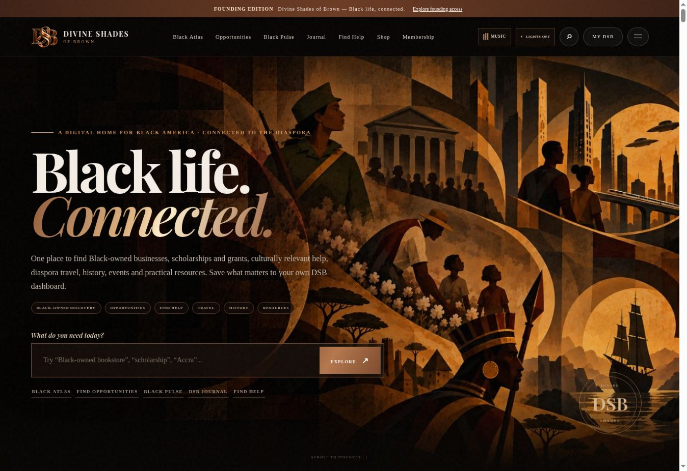
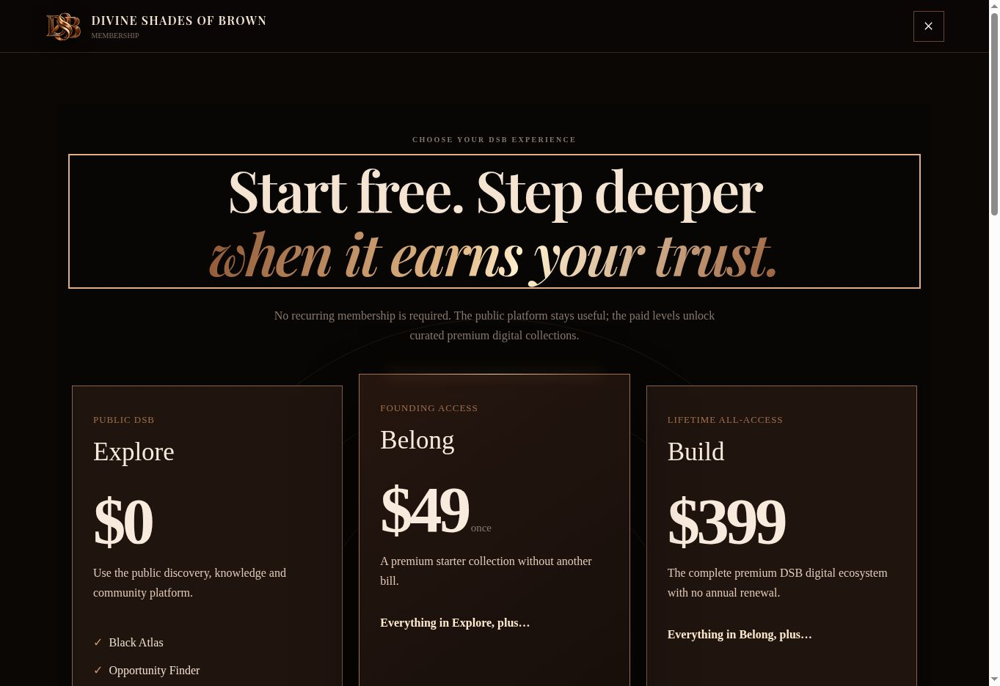
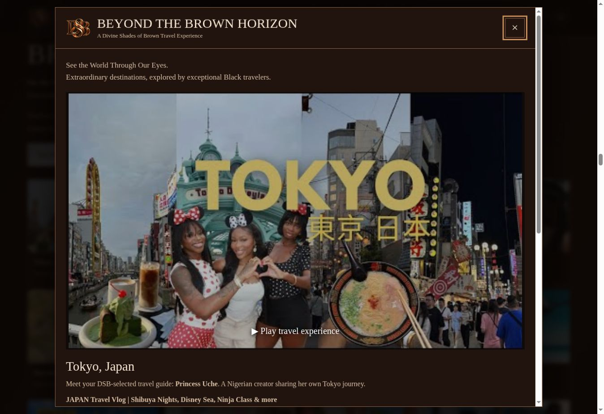

# DSB — Beyond the Brown Horizon and Membership Restoration

Live application build: `89cd167231f578a4b433cb9f187afcb7a0077cfa`. GitHub Pages workflows completed successfully. Public site: https://divineshadesofbrown.com/
Repository: https://github.com/inactentertainment/divine-shades-of-brown

## Existing structure preserved

Brown Passport is an editorial travel hub at `#travel`, with a toggleable Passport panel and existing Accra, Dakar, Kingston and Salvador destination previews. It is separate from Black Atlas, the geographic/business discovery tool. Personal Places I've Been records remain in LifeBook. No Passport renaming or personal-record migration occurred.

The existing six Unexpected America stays and four Essentials lodging resources remain. Their research and recommendations were not replaced. Controls on lodging resources open the global catalog and explicitly say that these videos are not reviews of those U.S. stays. No Switzerland lodging page or standalone country page was invented. Explore This Destination connects only to existing Accra, Salvador and Kingston Passport previews.

## Membership and banner

Restored large three-column pricing cards, prominent prices, spacious benefit lists, sharp silver shimmering buttons and inheritance labels. Membership now leads with these cards on one route. Existing benefits and checkout URLs remain. The jukebox has one full-width rectangular Membership control with cursive lettering and silver shimmer; it opens the membership route and closes the main jukebox panel.

- Explore: $0.
- Belong: $49 once, existing production Stripe URL unchanged.
- Build Founding Lifetime: $399 once, existing production Stripe URL unchanged.
- User-requested $3.99 curated art direction: displayed as forthcoming, with planned monthly art packages and a curated magazine. Billing period, release date, fulfillment and commercial/resale permissions require definition before enrollment. No checkout or charge was created for this offer.
- No $4.99 configuration was found; it was not introduced.

Supplied abstract DSB artwork is the hero background, converted to WebP without redrawing. A restrained dark veil protects copy while preserving the visible collage and initials. Image-backed hero text stays readable in light mode. Existing logos and homepage DSB circle were preserved.

## Travel implementation

A shared expandable catalog powers the showcase, native modal, contextual controls, exact creator/title/thumbnail records, and destination/region/creator/topic filters. Twelve featured records are an editorial flag, not a permanent maximum. Paging supports future additions. Official YouTube iframe API only; no media download, rehosting or restriction bypass. Switching videos destroys the previous player. Starting travel video stops the jukebox player; closing travel destroys its player. Direct Watch on YouTube links remain available. Error explanations distinguish actual YouTube error codes from unknown failures. Editorial selection does not assert creator partnership.

## Validation and limitations

| Check | Result |
|---|---|
| All 12 watch URLs and metadata | Retrieved exact public YouTube records; titles, channels, IDs and durations captured. |
| All 12 embed permissions | YouTube player response reported OK, public, playableInEmbed=true; oEmbed title/channel matched. |
| All 12 thumbnails | Official thumbnail endpoint returned image/jpeg. |
| Creator cultural focus and firsthand visit | Supported by linked creator self-descriptions, profiles and/or firsthand video descriptions; evidence retained in catalog. |
| All 12 browser selections | Correct official iframe video ID created, with one travel iframe after each switch. |
| Actual audiovisual playback | **Unverified.** Sampled Ghana player loaded controls and duration but remained at 0:00 with no ready media. Browser/network cause not established; no regional restriction asserted. |
| Desktop player | 12 choices; no horizontal overflow; readable poster and title; responsive 16:9 stage. |
| Phone/tablet layout | QA iframe at 360/390/768 CSS px (document client widths 345/375/753 because scrollbars). Modal fit without horizontal overflow. These are responsive browser checks, not physical device tests. |
| Light mode | Modal cream background rgb(236,221,200), dark text rgb(40,26,18); 12 choices retained; player aspect ratio 16:9. |
| Escape and focus | Modal closes and returns focus to launching Travel Experiences button; underlying travel route preserved. |
| Destination return | Ghana link closes player and opens/focuses actual Accra Passport preview; Salvador contextual launch and Escape also checked. |
| Travel menu route | Opens Beyond the Brown Horizon, original Passport and Unexpected America sections; menu closes. |
| Contextual launch sample | All 23 visible travel-route launch controls and all four Essentials lodging controls opened the shared modal and returned to their context. Destination-specific launches selected the correct record; generic lodging launches remained clearly labeled as the global collection. |
| Catalog filtering | Iceland search produces its single destination. |
| Jukebox regression | Existing 12 Voices of Greatness records remain. Les Brown player initialized; travel playback removed it; close removed travel iframe. Membership button opens correct route and hides main jukebox. |
| Existing Music/Meditation | Source and collection records preserved. Music genre and History controls and the Meditation recordings list opened successfully in the live browser; full playback not re-tested in this build. |
| Static validation | Changed JavaScript and inline scripts parsed; checkout URLs and existing lodging counts compared with baseline. |
| Payments/auth/backend | No billing, entitlements or backend changes. Transaction/auth flows not tested by this targeted build. |

No claim of global highest view count or independent copyright clearance is made. View counts below are snapshots from source checks on October 11, 2026, and will change. Embedding permission is separate from guaranteed playback in every browser or region. Artist/art commercial license language is pending; no blanket resale right is promised.

## Featured source records

| Destination | Creator / channel | Exact video title | Duration | Views at check | Watch URL | Embedding |
|---|---|---|---|---:|---|---|
| Tokyo, Japan | Princess Uche / Princess Uche | JAPAN Travel Vlog \| Shibuya Nights, Disney Sea, Ninja Class & more | 53:23 | 248,232 | https://www.youtube.com/watch?v=xC4kq2LorMI | Permitted; full playback unverified |
| Accra, Ghana | Tayo Aina / Tayo Aina | Accra Ghana IS NOT WHAT YOU THINK! Whats inside? | 12:49 | 529,997 | https://www.youtube.com/watch?v=_8m4DuHQVz0 | Permitted; full playback unverified |
| Skógafoss, Iceland | Jewells Chambers / All Things Iceland | Icelandic Hidden Gem Behind Skógafoss Waterfall | 8:05 | 14,679 | https://www.youtube.com/watch?v=etK18Ey_824 | Permitted; full playback unverified |
| Salvador, Brazil | Ace / ACE | The Black Side Of Brazil - Salvador Bahia | 63:39 | 482,525 | https://www.youtube.com/watch?v=LC-acf2hFyY | Permitted; full playback unverified |
| Marrakech, Morocco | Raven Navera / Raven Navera | 🇲🇦 MARRAKECH PART 2: What it's like travelling to Marrakech as a black woman. | 18:45 | 20,545 | https://www.youtube.com/watch?v=0zwdw8TjPBg | Permitted; full playback unverified |
| Johannesburg, South Africa | Miss Trudy / Miss Trudy | Best Place To Visit Johannesburg?/South Africa Vlog! | 12:27 | 62,685 | https://www.youtube.com/watch?v=0gDXRJKZgoU | Permitted; full playback unverified |
| Bern, Switzerland | African Tigress / AFRICAN TIGRESS | Switzerland Is Too Much ! A Day in Bern | 27:27 | 27,227 | https://www.youtube.com/watch?v=Daa0BM2W4sY | Permitted; full playback unverified |
| Bali, Indonesia | Jubril Agoro / PassportHeavy | Bali Luxury Travel Guide \| PassportHeavy.com | 15:11 | 177,067 | https://www.youtube.com/watch?v=ibYusnvd4_4 | Permitted; full playback unverified |
| Egypt | The Chews / Chews to Explore | 12 EGYPT Travel Tips that NO ONE Will Tell YOU! | 19:32 | 181,195 | https://www.youtube.com/watch?v=M7SLOZfgY7A | Permitted; full playback unverified |
| Auckland, New Zealand | Tasha Kayys / Tasha Kayys | Vlog: TRAVEL IN NEW ZEALAND pt2🛍️👗☀️black girl NZ, things to do in Auckland😍\| South African/Zambian | 14:57 | 594 | https://www.youtube.com/watch?v=BEl4mXuShHk | Permitted; full playback unverified |
| Jamaica | Kemoy Martin / Kemoy Martin | The Jamaica They Don’t Show You: We Ate Like REAL Jamaicans | 32:01 | 24,993 | https://www.youtube.com/watch?v=ZH-ZaXJzrTI | Permitted; full playback unverified |
| São Tomé & Príncipe | Wode Maya / WODE MAYA | I Visited the African Country You've Never Heard Of 🇸🇹 (São Tomé & Príncipe) | 64:55 | 1,363,301 | https://www.youtube.com/watch?v=1XPdXAnwB7c | Permitted; full playback unverified |

Final QA found that the original Brown Passport article title did not match the travel keyword rule. The rule now includes Passport, without changing article content.

## Files changed

- `index.html`: integration, membership copy, forthcoming art offer, shared assets.
- `assets/dsb-banner-art.webp`: supplied hero art.
- `assets/dsb-horizon.css`: targeted hero, membership and travel presentation.
- `assets/dsb-horizon.js`: shared travel modal and contextual launches.
- `assets/dsb-travel-catalog.js`: 12 verified source records and expandable metadata.
- `assets/dsb-navigation.js`: travel/membership route ordering and player cross-link handling.
- `assets/dsb-jukebox.js`: mutual playback coordination only.
- `qa/viewport.html`: responsive live QA fixture.
- `docs/DSB_PROJECT_DECISIONS.md`: approved direction and outstanding pricing/licensing decisions.
- `docs/dsb-travel-source-checks.json`: source metadata and creator evidence.

## Live screenshots

